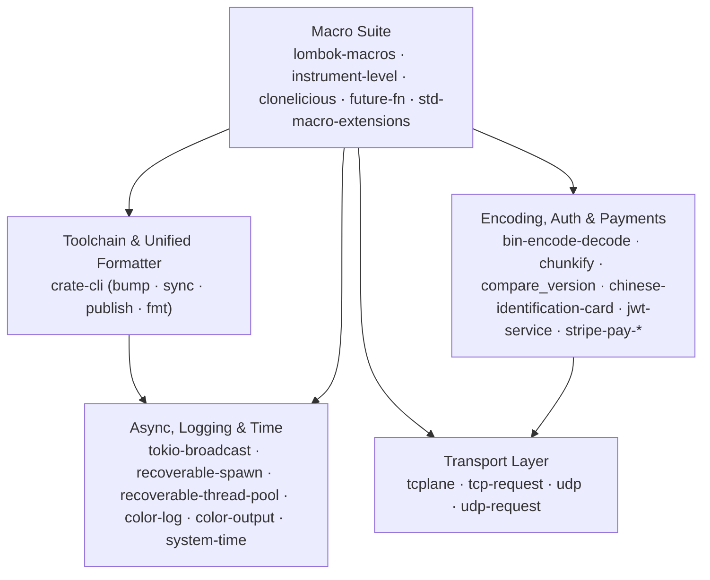

<div align="center">

# ctares

**Unified Rust 2024 Workspace for Core Macros, CLI Tooling, Async Concurrency, Networking, Security & Payments**

[](https://github.com/crates-dev/ctares/actions)
[](https://www.rust-lang.org)
[](./LICENSE)

[Workspace Matrix](#workspace-matrix) · [Architecture](#architecture) · [Quick Start](#quick-start) · [Unified Formatter (`crate fmt`)](#unified-formatter-crate-fmt) · [Verification](#verification) · [Agent Governance](./AGENTS.md)

</div>

---

## Overview

**ctares** is the foundational monorepo under the [`crates-dev`](https://github.com/crates-dev) GitHub organization. It consolidates **24** independently published Rust crates into a single version-synchronized Cargo workspace while preserving each crate's isolated directory layout, unit/integration test suite, and independent `crates.io` release lifecycle.

It powers upstream developer tooling and shared runtime primitives across the `euv`, `hyperlane`, `hyperlane-quick-start`, and `commerce-suite` ecosystem.

---

## Architecture



---

## Workspace Matrix

### Toolchain & Unified Formatter

| Crate                                | crates.io                                                                                      | docs.rs                                                                                            | Responsibility                                                                                                                            |
| :----------------------------------- | :--------------------------------------------------------------------------------------------- | :------------------------------------------------------------------------------------------------- | :---------------------------------------------------------------------------------------------------------------------------------------- |
| [`crate-cli`](./crate-cli/README.md) | [](https://crates.io/crates/crate-cli) | [](https://docs.rs/crate-cli) | Cargo lifecycle CLI (`bump`, `sync`, `publish`, `fmt`) with VS Code Prettier 3.7.4 & Taplo 0.7.0 aligned unified text and Rust formatting |

### Procedural & Declarative Macros

| Crate                                                      | crates.io                                                                                                            | docs.rs                                                                                                                  | Responsibility                                                                                      |
| :--------------------------------------------------------- | :------------------------------------------------------------------------------------------------------------------- | :----------------------------------------------------------------------------------------------------------------------- | :-------------------------------------------------------------------------------------------------- |
| [`lombok-macros`](./lombok-macros/README.md)               | [](https://crates.io/crates/lombok-macros)               | [](https://docs.rs/lombok-macros)               | Derive macros for `Getter`, `GetterMut`, `Setter`, `Data`, `New`, `CustomDebug`, and `DisplayDebug` |
| [`instrument-level`](./instrument-level/README.md)         | [](https://crates.io/crates/instrument-level)         | [](https://docs.rs/instrument-level)         | Tracing instrumentation attribute macros by log level (`trace`, `debug`, `info`, `warn`, `error`)   |
| [`clonelicious`](./clonelicious/README.md)                 | [](https://crates.io/crates/clonelicious)                 | [](https://docs.rs/clonelicious)                 | Concise `clone!` macro for cloning captured state before closure invocation                         |
| [`future-fn`](./future-fn/README.md)                       | [](https://crates.io/crates/future-fn)                       | [](https://docs.rs/future-fn)                       | Ergonomic macros for async closures capturing owned values by move                                  |
| [`std-macro-extensions`](./std-macro-extensions/README.md) | [](https://crates.io/crates/std-macro-extensions) | [](https://docs.rs/std-macro-extensions) | Standard library collection, smart pointer, sync primitive, and I/O helper macros                   |

### Logging, Console & Async Concurrency

| Crate                                                            | crates.io                                                                                                                  | docs.rs                                                                                                                        | Responsibility                                                                    |
| :--------------------------------------------------------------- | :------------------------------------------------------------------------------------------------------------------------- | :----------------------------------------------------------------------------------------------------------------------------- | :-------------------------------------------------------------------------------- |
| [`color-output`](./color-output/README.md)                       | [](https://crates.io/crates/color-output)                       | [](https://docs.rs/color-output)                       | Atomic ANSI colored console output functions and builder API                      |
| [`color-log`](./color-log/README.md)                             | [](https://crates.io/crates/color-log)                             | [](https://docs.rs/color-log)                             | Sync and Tokio-async logger with custom handlers and size-based log file rotation |
| [`tokio-broadcast`](./tokio-broadcast/README.md)                 | [](https://crates.io/crates/tokio-broadcast)                 | [](https://docs.rs/tokio-broadcast)                 | High-throughput `Broadcast` and keyed `BroadcastMap` pub/sub channels over Tokio  |
| [`recoverable-spawn`](./recoverable-spawn/README.md)             | [](https://crates.io/crates/recoverable-spawn)             | [](https://docs.rs/recoverable-spawn)             | Panic-catching sync and async task spawners with recovery hooks                   |
| [`recoverable-thread-pool`](./recoverable-thread-pool/README.md) | [](https://crates.io/crates/recoverable-thread-pool) | [](https://docs.rs/recoverable-thread-pool) | Self-healing worker thread pool built atop `recoverable-spawn`                    |

### Data Processing, Auth & Payments

| Crate                                                                    | crates.io                                                                                                                          | docs.rs                                                                                                                                | Responsibility                                                                  |
| :----------------------------------------------------------------------- | :--------------------------------------------------------------------------------------------------------------------------------- | :------------------------------------------------------------------------------------------------------------------------------------- | :------------------------------------------------------------------------------ |
| [`bin-encode-decode`](./bin-encode-decode/README.md)                     | [](https://crates.io/crates/bin-encode-decode)                     | [](https://docs.rs/bin-encode-decode)                     | Binary encoding and decoding with customizable character sets beyond Base64     |
| [`chunkify`](./chunkify/README.md)                                       | [](https://crates.io/crates/chunkify)                                       | [](https://docs.rs/chunkify)                                       | Deterministic byte/file chunk splitting and resumable reassembly                |
| [`compare_version`](./compare-version/README.md)                         | [](https://crates.io/crates/compare_version)                         | [](https://docs.rs/compare_version)                         | Semantic version parsing, ordering, and compatibility verification              |
| [`system-time`](./system-time/README.md)                                 | [](https://crates.io/crates/system-time)                                 | [](https://docs.rs/system-time)                                 | Locale-aware system clock formatting and timestamp helpers                      |
| [`chinese-identification-card`](./chinese-identification-card/README.md) | [](https://crates.io/crates/chinese-identification-card) | [](https://docs.rs/chinese-identification-card) | GB 11643 Chinese resident ID validation and checksum verification               |
| [`jwt-service`](./jwt-service/README.md)                                 | [](https://crates.io/crates/jwt-service)                                 | [](https://docs.rs/jwt-service)                                 | Async JWT generation, verification, and typed custom claims                     |
| [`stripe-pay-core`](./stripe-pay-core/README.md)                         | [](https://crates.io/crates/stripe-pay-core)                         | [](https://docs.rs/stripe-pay-core)                         | Shared Stripe payment domain types, money precision, and form encoding          |
| [`stripe-pay-server`](./stripe-pay-server/README.md)                     | [](https://crates.io/crates/stripe-pay-server)                     | [](https://docs.rs/stripe-pay-server)                     | Server-side Stripe transport and constant-time HMAC-SHA256 webhook verification |
| [`stripe-pay-client`](./stripe-pay-client/README.md)                     | [](https://crates.io/crates/stripe-pay-client)                     | [](https://docs.rs/stripe-pay-client)                     | Browser/WASM Stripe checkout element configuration over `stripe-pay-core`       |

### Networking & Transport

| Crate                                    | crates.io                                                                                          | docs.rs                                                                                                | Responsibility                                                          |
| :--------------------------------------- | :------------------------------------------------------------------------------------------------- | :----------------------------------------------------------------------------------------------------- | :---------------------------------------------------------------------- |
| [`tcplane`](./tcplane/README.md)         | [](https://crates.io/crates/tcplane)         | [](https://docs.rs/tcplane)         | Lightweight Tokio async TCP server with hooks and connection lifecycle  |
| [`tcp-request`](./tcp-request/README.md) | [](https://crates.io/crates/tcp-request) | [](https://docs.rs/tcp-request) | Raw synchronous TCP request client with redirect and response support   |
| [`udp`](./udp/README.md)                 | [](https://crates.io/crates/udp)                 | [](https://docs.rs/udp)                 | Lightweight Tokio async UDP datagram server with request-response hooks |
| [`udp-request`](./udp-request/README.md) | [](https://crates.io/crates/udp-request) | [](https://docs.rs/udp-request) | Raw UDP datagram request/response client                                |

---

## Quick Start

Install the workspace CLI globally or invoke any crate directly from `crates.io`:

```sh
cargo install crate-cli
crate fmt --check
```

Or add any individual library crate to your project:

```sh
cargo add lombok-macros color-output tokio-broadcast
```

---

## Unified Formatter (`crate fmt`)

`crate-cli` provides the ecosystem's single source of truth for multi-language text and Rust formatting, aligned with VS Code's `esbenp.prettier-vscode` (Prettier 3.7.4: `tabWidth: 2`, `singleQuote: true`, `semi: true`, `printWidth: 80`, `proseWrap: "preserve"`, `bracketSpacing: true`, `trailingComma: "all"`, `arrowParens: "always"`, `jsxSingleQuote: false`, `objectWrap: "preserve"`, `vueIndentScriptAndStyle: false`, `endOfLine: "lf"`), `tamasfe.even-better-toml` (Taplo 0.7.0 `tabSize = 4`), and `rustfmt`:

- **Markdown** (`.md`, `.markdown`, `.mdx`): YAML frontmatter, CJK/emoji-width-aware GFM tables, lists, blockquotes, Prettier `singleQuote: true` link titles, empty fenced code blocks, and Prettier-supported embedded fences (`js`/`ts`/`json`/`yaml`/`css`/`scss`/`less`/`html`/`vue`/`md`, leaving `toml`/`sh`/`bash`/`rust` verbatim).
- **YAML** (`.yml`, `.yaml`, `.prettierrc`): 2-space indentation, single-quoted scalars, 80-column flow wrapping/collapse, verbatim block scalars, GitHub Actions `${{ ... }}` preservation, and `.prettierrc` JSON/YAML auto-detection.
- **JSON / JSON-Stringify / JSONC** (`.json`, `package.json`, `package-lock.json`, `composer.json`, `.jsonc`, `.cjson`): `objectWrap: "preserve"` for `.json` (with comments allowed and trailing commas stripped for `tsconfig.json`/`.vscode/settings.json`), always-expanded `json-stringify` for package manifests, and comment plus trailing-comma retention for `.jsonc`/`.cjson`.
- **TOML** (`.toml`): Taplo 0.7.0 defaults (`tabSize = 4`, 80-column array/inline-table auto-expand, short-array auto-collapse, `allowed_blank_lines = 2`, `align_comments = true`, verbatim fallback on invalid TOML).
- **Web Languages** (`.js`, `.mjs`, `.cjs`, `.wxs`, `.ts`, `.mts`, `.cts`, `.tsx`, `.css`, `.wxss`, `.scss`, `.less`, `.html`, `.htm`, `.vue`): Full Prettier 3.7.4 formatting including embedded HTML/Vue `<script>` and `<style>` blocks.
- **VS Code No-Op Preservation & `.prettierignore`**: Unformatted text/config/script files (`LICENSE`, `.gitattributes`, `.gitignore`, `.dockerignore`, `.editorconfig`, `pre-commit`, `.sh`/`.bash`/`.zsh`, `Makefile`, `Dockerfile`, `.env`, `.txt`, `.conf`, `.ini`, `.xml`, `.svg`, `.py`, `.sql`, `.jsx`, `Cargo.lock`) are preserved byte-for-byte; workspace-root `.prettierignore` rules and symlink-loop guards are honored during traversal.
- **Rust** (`.rs`): Deterministic `#[derive(...)]` sorting + `cargo fmt`.
- **Library Entry Points**: Downstream CLIs (`euv fmt`, `hyperlane fmt`) invoke `crate_cli::execute_unified_fmt`, `crate_cli::format_workspace_text_files`, and `crate_cli::format_text_by_path` as their first pass before framework-specific formatting.

---

## Verification

Run the complete local verification suite matching `.github/workflows/rust.yml`:

```sh
cargo run -p crate-cli -- fmt
cargo run -p crate-cli -- fmt --check
cargo fmt --all -- --check
cargo clippy --workspace --all-features --all-targets -- -D warnings
cargo test --workspace --all-features
cargo check --release --workspace --all-features
```

---

## Documentation & Governance

- Engineering architecture, crate boundaries, release cascade, and documentation maintenance triggers are defined in [`AGENTS.md`](./AGENTS.md).
- Project-specific agent workflow standards are maintained in [`.agents/skills/ctares/SKILL.md`](./.agents/skills/ctares/SKILL.md).

## License

This project is licensed under the MIT License. See the [LICENSE](./LICENSE) file for details.

## Contributing

Contributions are welcome! Please follow the rules in [`AGENTS.md`](./AGENTS.md) and open a pull request.

## Contact

For inquiries, please contact the author at [root@devhub.vip](mailto:root@devhub.vip).
